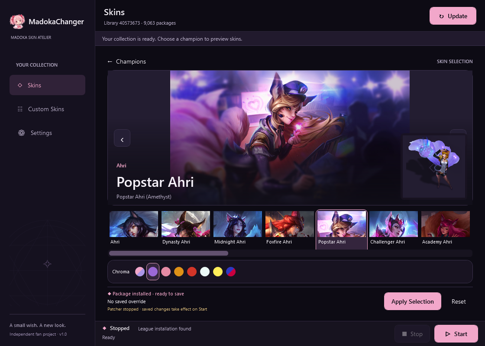

<div align="center">
  
  <h1>MadokaChanger</h1>
  <p><b>A small wish. A new look.</b></p>
  <p>A dark, Madoka-inspired Windows skin library and custom-skin manager for League of Legends.</p>
  <p>
    <a href="https://github.com/hellohello143/MadokaChanger/releases/latest"><b>Download for Windows</b></a>
    &nbsp;·&nbsp;
    <a href="#getting-started">Getting started</a>
    &nbsp;·&nbsp;
    <a href="docs/BUILDING.md">Build from source</a>
  </p>
  <p>
    
    
    
    <a href="LICENSE"></a>
  </p>
</div>



## What you get

- **Ready-to-install app.** The installer includes the .NET runtime and complete backend. No backend folder selection or separate LTK installation.
- **A cleaner champion library.** Search by name, mark favorites and keep one saved skin/chroma/form per champion. Classic/Jade entries are excluded.
- **A preview that stays in view.** Artwork, the skin strip, chroma color circles and Apply/Reset remain visible in smaller windows without vertical page scrolling.
- **Your own custom skins.** Import supported `.fantome`, `.modpkg` and Fantome ZIP packages, review conflicts, and enable or uninstall imports.
- **A dark desktop experience.** Pink and plum styling, a chibi icon, compact navigation, responsive panels and reduced-motion support.
- **Recoverable library updates.** Downloads are validated and staged before activation. An interrupted update keeps the previous working library.

## Install

1. Open the [latest release](https://github.com/hellohello143/MadokaChanger/releases/latest).
2. Download **MadokaChanger-Setup-1.0.1.exe** and run it.
3. Choose the installation folder and whether to create a desktop shortcut.
4. Launch **MadokaChanger** from the desktop or Start menu.

Requires **Windows 10/11 x64**. The installer includes .NET 10 and installs for the current user; installation does not require administrator access. Starting a session does not ask for administrator access either, unless League itself is set to run as administrator or you turn on **Run patcher as administrator** in Settings. If LTK Manager is installed, MadokaChanger uses its signed patcher automatically. This release is unsigned; SHA-256 checksums are attached to the release.

The default installation is `%LOCALAPPDATA%\Programs\MadokaChanger`. Uninstall through Windows **Installed apps**. Settings, downloaded skins and imported content are kept separately and preserved when uninstalling.

## Getting started

1. **Find League.** Open Settings and detect or choose the League `Game` folder, then save.
2. **Install the skin library.** This downloads the supported package collection. It requires an Internet connection and enough disk space for the library and update staging.
3. **Choose your look.** Search for a champion, select a skin, use the color circles for chromas or choose an available special form, then click **Apply Selection**.
4. **Start a session.** Close any running League game, click **Start**, and launch League normally. Click **Stop** when finished.

Preview-only variants cannot be applied. Selections saved during a session take effect after **Stop → Start**. Importing and library updates are blocked while a session is active.

## Build from source

You need the **.NET 10 SDK**, **Rust** with a Windows C/C++ toolchain, and **Inno Setup 6.7.3 or later** (7.x works) to build the installer.

```powershell
git clone https://github.com/hellohello143/MadokaChanger.git
cd MadokaChanger

./scripts/build-native.ps1
./scripts/publish.ps1
./scripts/build-installer.ps1 -Version 1.0.1
```

The published app appears in `artifacts/win-x64/`; the installer and checksums appear in `artifacts/installer/`. If Inno Setup is outside its default location, pass `-CompilerPath "C:\path\to\ISCC.exe"`.

The native adapter is built from the pinned Rust sources. The publish script prepares and verifies the bundled patcher dependencies automatically. Compiled app binaries, local data and installer outputs are excluded from Git.

See [building and development](docs/BUILDING.md) for toolchain details and isolated verification commands, and [installer packaging](docs/INSTALLER.md) for installation and release behavior.

## Validation and compatibility

The release passes **59 automated tests** and off-screen WPF checks across small and large window sizes, including 125% and 150% render scales. The installer payload is checked with an isolated install/uninstall smoke test.

**Live patcher attachment and in-game rendering have not been verified for this build.** Compatibility depends on the installed League patch and bundled backend. A running/scanning host is not proof that a skin rendered successfully in-game; the status bar switches to **In game · skins applied** only once League actually loads a modded archive. Errors are surfaced in the app and its local logs.

## Project notes

- [Changelog](CHANGELOG.md)
- [Storage and recovery](docs/STORAGE.md)
- [Backend integration](docs/BACKEND.md)
- [Upstream versions and formats](docs/UPSTREAM.md)
- [Verification report](verification/VERIFICATION.md)
- [Third-party notices](THIRD_PARTY_NOTICES.md)

First-party source is licensed under [Apache-2.0](LICENSE). The bundled patcher has its own [LTK Patcher License](licenses/LTK-PATCHER-LICENSE.md); its upstream signatures are removed as required, with provenance recorded in `backend/backend-manifest.json`.

MadokaChanger is an independent fan project and is not affiliated with or endorsed by Riot Games or League Toolkit. Riot game art and Madoka Kaname belong to their respective rights holders. Skin packages and game artwork are downloaded at runtime rather than included in the installer.
